# Secure Connect and Communication Platform

**Course:** Web Dev-III | **Assignment:** Lab 4 (Unit 4)
**Name:** Aark Bharti | **Roll No.:** 2501730503 | **Programme:** B.Tech CSE (AI & ML), Section G

A backend built with Node.js and Express where users can sign up, log in, reach protected routes with a JWT, manage their own notes, and chat in real time with Socket.IO. No authentication boilerplate or starter kit is used.

## Features

- Signup and login with bcrypt password hashing
- JWT authentication (Bearer header or httpOnly cookie)
- Protected routes and role-based access control (user / admin)
- Notes API with full CRUD, where each user can only access their own notes
- Real-time chat in rooms, with the Socket.IO connection itself authenticated by JWT
- Event-driven logging with Node.js EventEmitter
- Secrets kept in a `.env` file with dotenv

## Tech stack

Node.js, Express, jsonwebtoken, bcrypt, dotenv, Socket.IO. Data is stored in small JSON files under `data/` (created automatically), so no database server is needed. Ids are 24-character hex strings, like MongoDB ObjectIds.

## Getting started

```bash
npm install
cp .env.example .env     # then set JWT_SECRET to any long random string
node server.js           # http://localhost:5000
```

To see the chat working, start the server and run this in a second terminal:

```bash
node scripts/chat-demo.js
```

### Environment variables

| Variable | Purpose |
|---|---|
| `PORT` | Server port (default 5000) |
| `JWT_SECRET` | Secret used to sign tokens |
| `JWT_EXPIRES_IN` | Token lifetime, for example `1h` |
| `BCRYPT_ROUNDS` | bcrypt salt rounds |
| `ADMIN_EMAIL` | The account that signs up with this email gets the admin role |

## API endpoints

| Method | Endpoint | Access | Purpose |
|---|---|---|---|
| POST | `/api/auth/signup` | Public | Register a user |
| POST | `/api/auth/login` | Public | Log in and receive a JWT |
| POST | `/api/auth/logout` | Public | Clear the token cookie |
| GET | `/api/auth/me` | Token | Current user profile |
| POST | `/api/notes` | Token | Create a note |
| GET | `/api/notes` | Token | List own notes |
| GET | `/api/notes/:id` | Token + owner | Read one note |
| PUT | `/api/notes/:id` | Token + owner | Update a note |
| DELETE | `/api/notes/:id` | Token + owner | Delete a note |
| GET | `/api/admin/users` | Admin only | List all users |
| GET | `/api/admin/messages` | Admin only | List all chat messages |

**Socket.IO events:** `joinRoom`, `chatMessage`, `typing` (client to server), and `chatMessage`, `systemMessage`, `typing`, `errorMessage` (server to client). The client connects with `io(url, { auth: { token } })`.

## Project structure

```
server.js                 entry point (Express + HTTP server)
scripts/chat-demo.js      two-user chat demo
src/
  db.js                   JSON-file collections
  events.js               EventEmitter and listeners
  socket.js               Socket.IO server with JWT handshake
  middleware/auth.js      authenticate and authorize (RBAC)
  routes/auth.js          signup, login, logout, me
  routes/notes.js         notes CRUD
  routes/admin.js         admin-only routes
```

## Output screenshots

### Signup and login

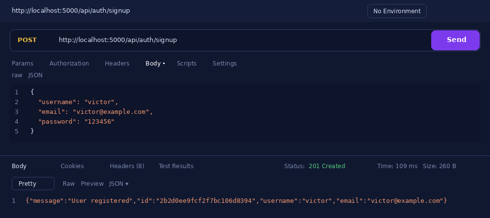
*Fig 1. Signup returns 201 Created. The password is never returned.*

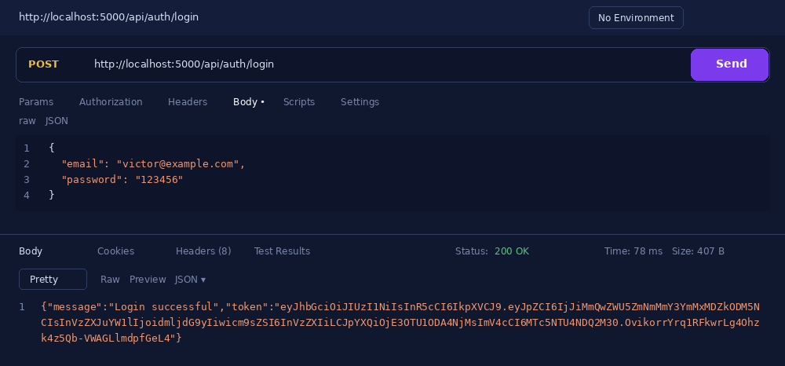
*Fig 2. Login returns 200 OK with a signed JWT.*

### Protected routes and Notes API

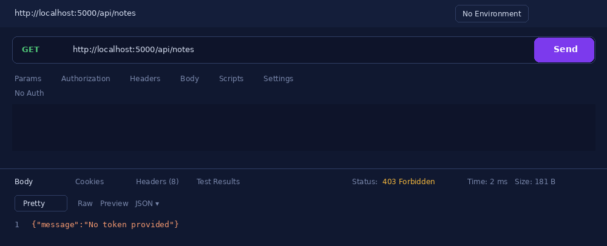
*Fig 3. Notes API is blocked without a token (403).*


*Fig 4. Creating the first note with a valid JWT (201).*

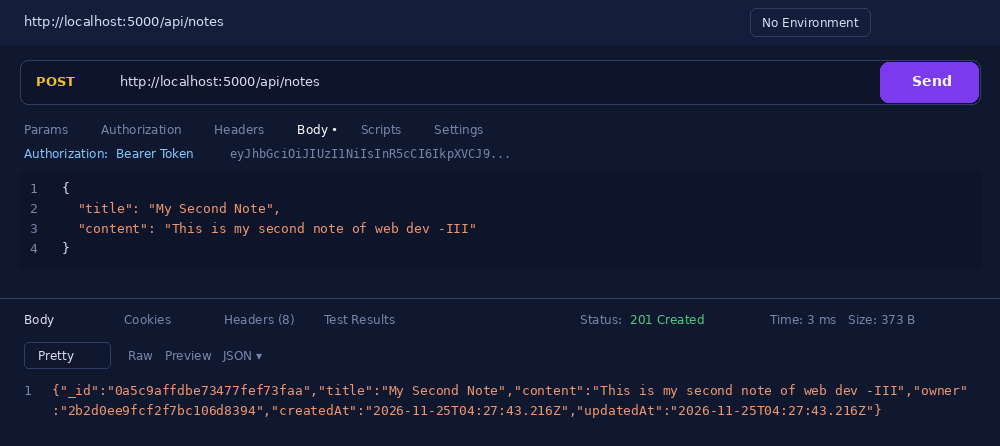
*Fig 5. Creating a second note.*

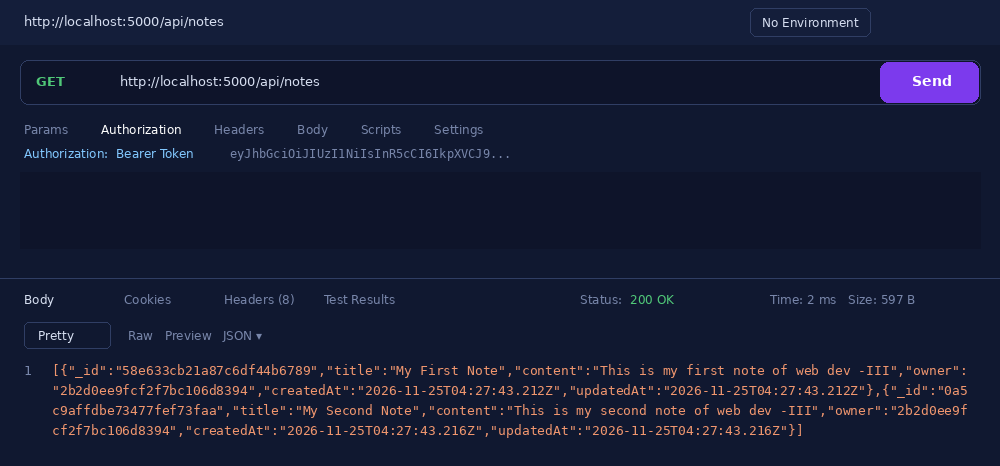
*Fig 6. Listing notes with a valid JWT returns only the logged-in user's notes.*

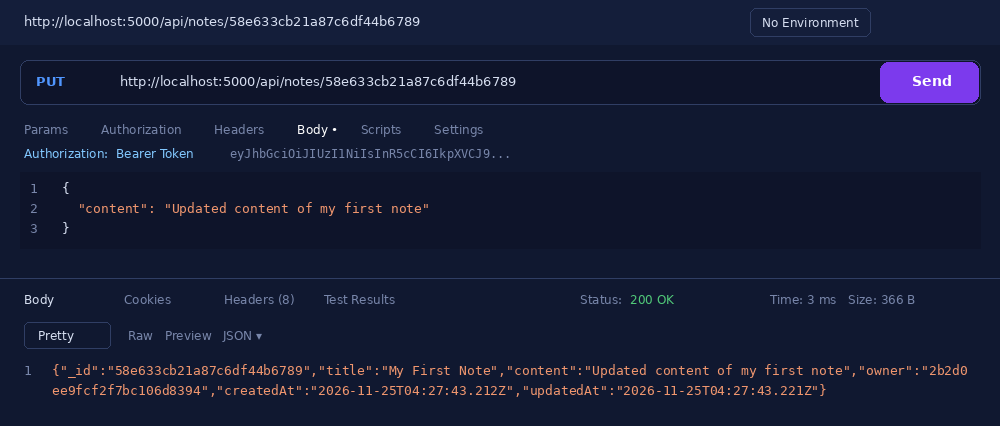
*Fig 7. Updating a note refreshes `updatedAt`.*

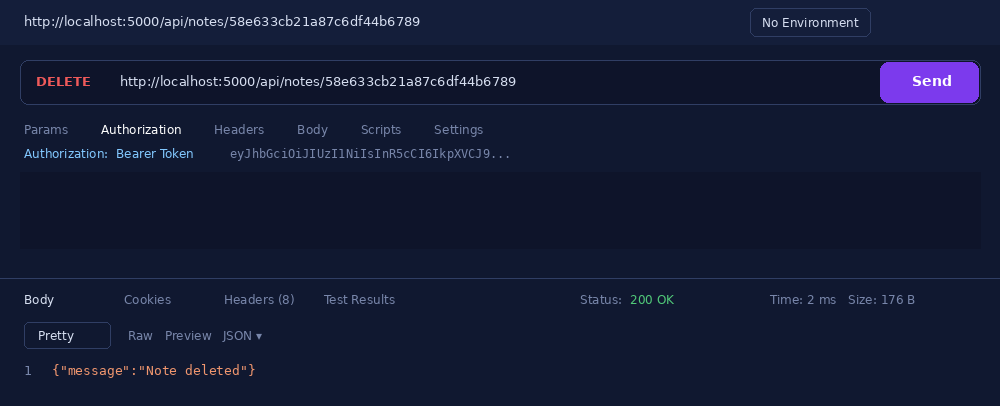
*Fig 8. Deleting a note.*

### Authorization and validation

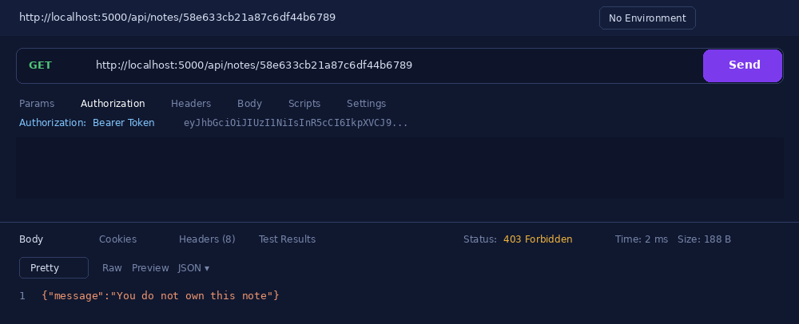
*Fig 9. Another user opening this note gets 403.*

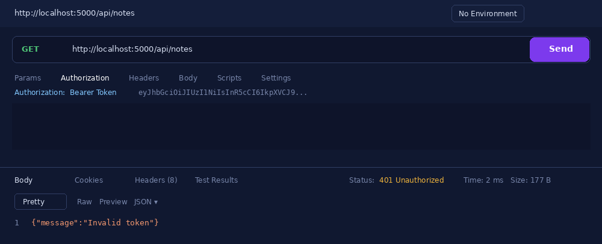
*Fig 10. An invalid token is rejected with 401.*

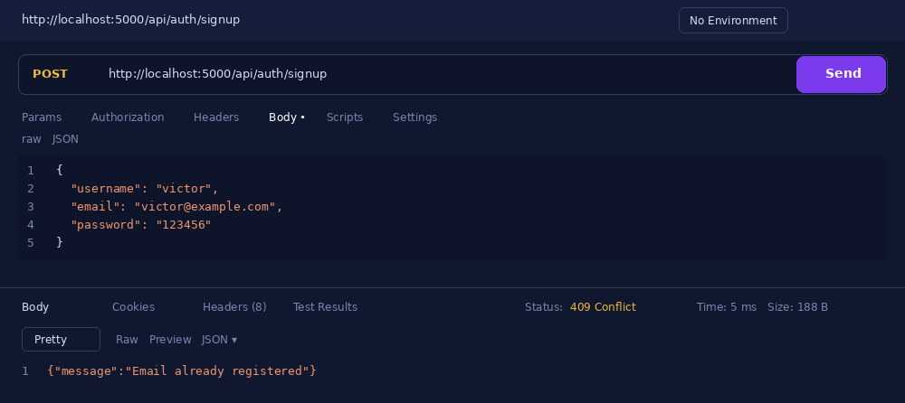
*Fig 11. Signing up with an existing email returns 409.*

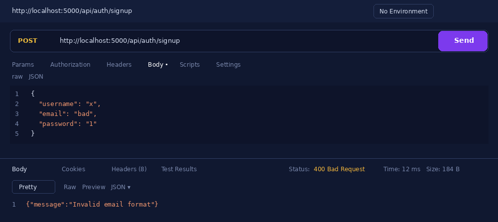
*Fig 12. Invalid signup data returns 400.*

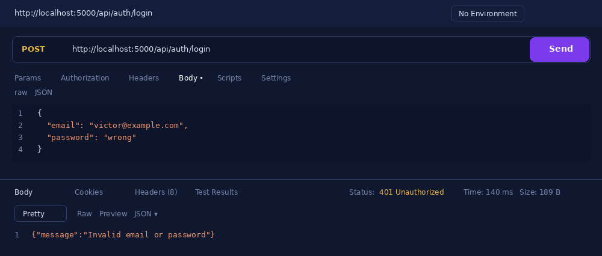
*Fig 13. A wrong password returns 401 without saying which field was wrong.*

### Role-based access control

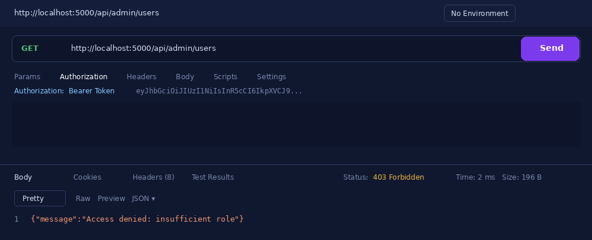
*Fig 14. A normal user calling an admin route gets 403.*

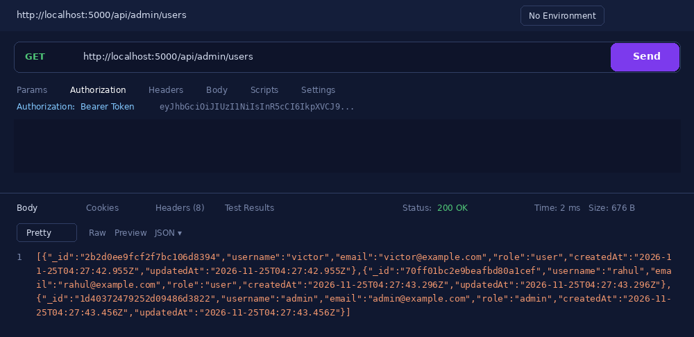
*Fig 15. The admin gets the user list, with password hashes removed.*

### Real-time chat and events

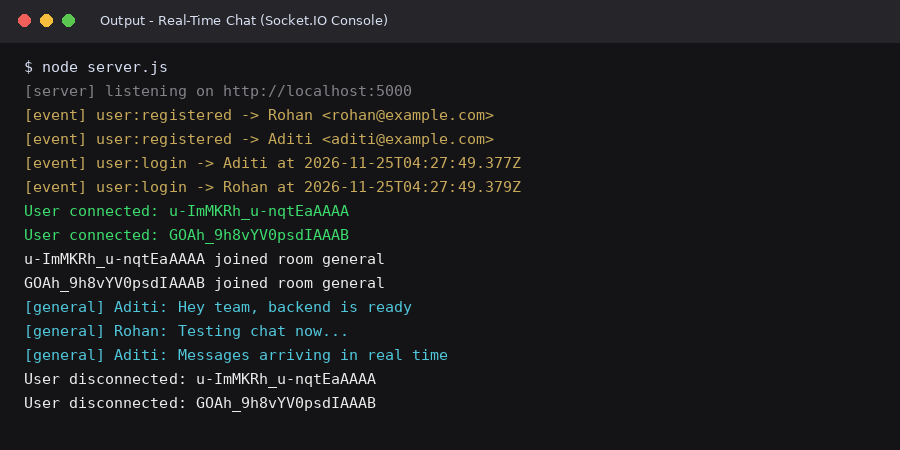
*Fig 16. Real-time chat activity logged via Socket.IO.*

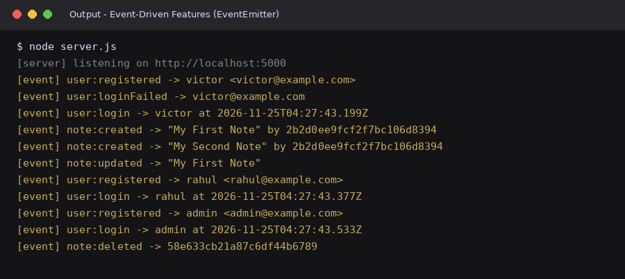
*Fig 17. EventEmitter events logged by the server.*

## How the security works

1. Passwords are hashed with bcrypt before saving, so the plain text is never stored.
2. On login the server signs a JWT containing the user id, username and role.
3. The `authenticate` middleware verifies the token on every protected route and Socket.IO connection.
4. The `authorize` middleware checks the role before admin routes run.
5. Notes are looked up by id and then checked against the token's user id, so users cannot read or change each other's notes.
6. `.env` and `data/` are listed in `.gitignore` and never pushed to GitHub.
